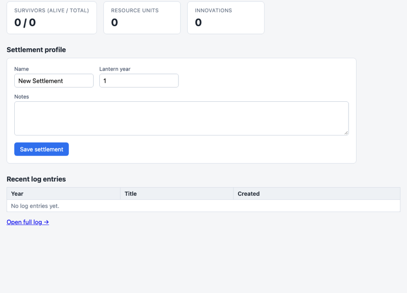
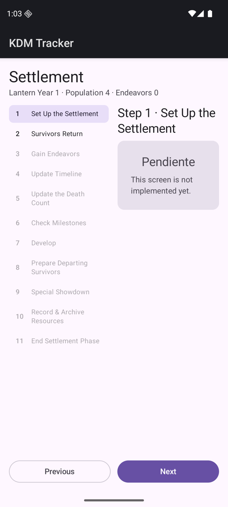
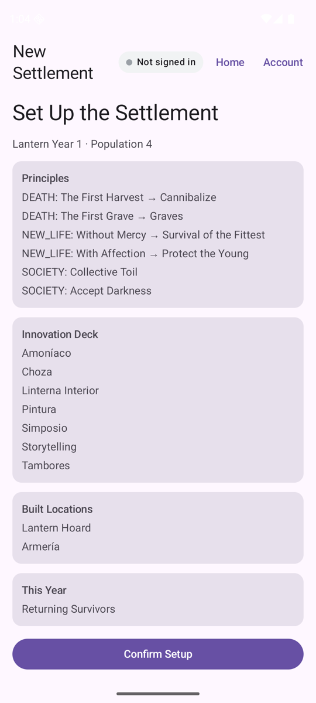
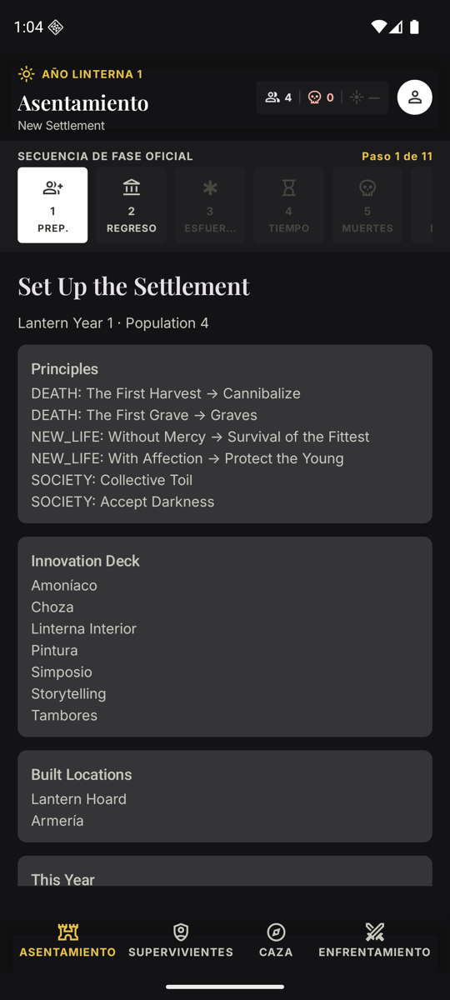
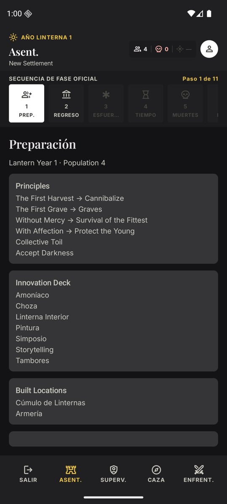

# kdm-tracker

**Campaign and settlement tracker for Kingdom Death: Monster. An Android app that works offline.**

[Español](README.md) · [English](README.en.md)

[](https://github.com/Alountk/kdm-tracker/actions/workflows/ci.yml)
[](https://github.com/Alountk/kdm-tracker/releases/latest)
[](LICENSE)

<table>
  <tr>
    <td></td>
    <td></td>
    <td></td>
    <td></td>
  </tr>
  <tr align="center">
    <td>Settlement</td>
    <td>Survivors</td>
    <td>Hunt</td>
    <td>Showdown</td>
  </tr>
</table>

The app's interface is in Spanish.

## What it is

A phone app for running a Kingdom Death: Monster campaign through the whole **lantern year**: the
settlement phase (its 11 steps), each survivor's sheet, the hunt on its board and the showdown with
the monster.

- **Offline first.** Everything is stored on the device; you do not need a server to play.
- **Optional sync.** With a server of your own you can share a campaign with other players through
  an invite code.
- **Rules are data.** Game content lives in content packs, not in code, so editions and expansions
  can be added without touching the rules engine.

## Status

Pre-release (**v0.3**), under active development. The bundled content is a seed of the 1.6 edition
plus the already-processed 1.5 cards, not the complete game. What is missing and the planned order
are in the [roadmap](docs/roadmap.md).

## Install

Download the APK from the [latest release](https://github.com/Alountk/kdm-tracker/releases/latest)
and install it on Android 7.0 or newer (you have to allow installs from unknown sources). No account
or server is needed.

## Develop

```bash
git clone https://github.com/Alountk/kdm-tracker.git && cd kdm-tracker
./gradlew :app-android:assembleDebug     # APK in app-android/build/outputs/apk/debug/
./gradlew spotlessCheck :core:jvmTest :data:jvmTest :server:test :app-android:testDebugUnitTest
```

You need JDK 21 and the **Android SDK, even for tasks that are not Android**. How to install it, run
the server, use Docker and publish a release: [development guide](docs/development.md).

## How it is built

| Module | Contents |
| --- | --- |
| `core` | Domain and rules in pure multiplatform Kotlin: lantern year, content, sync engine |
| `data` | Local persistence with SQLDelight (SQLite) |
| `app-android` | Compose Multiplatform + Material 3 app |
| `server` | Spring Boot server: sync hub and web dashboard |

Layer rules and the code-comment convention are in [ARCHITECTURE.md](docs/ARCHITECTURE.md).

## Evolution

<table>
  <tr align="center">
    <td colspan="4"><br>3 Oct · web dashboard</td>
  </tr>
  <tr align="center" valign="top">
    <td><br>5 Oct · first app</td>
    <td><br>9 Oct · working step 1</td>
    <td><br>10 Oct · Atramentum theme</td>
    <td><br>today</td>
  </tr>
</table>

| Date | Milestone |
| --- | --- |
| 3 Oct 2026 | First settlement manager: web dashboard with survivors, resources, innovations and a log |
| 5 Oct 2026 | Android app skeleton on top of the `core` rules engine |
| 6 Oct 2026 | Sync hub: authentication, incremental changes and data migration |
| 7 Oct 2026 | 1.5 edition cards turned into content packs |
| 9 Oct 2026 | Showdown phase: setup, AI deck and aftermath |
| 10 Oct 2026 | "Atramentum" visual theme and a four-tab app shell |
| 18 Oct 2026 | Paged survivor sheet and the hunt screen |
| 23 Oct 2026 | Hunt board steps and a per-space roll |
| 27 Oct 2026 | Continuous integration and the first signed release (v0.3.0) |

## Documentation

These documents are written in English.

| Document | Contents |
| --- | --- |
| [Development guide](docs/development.md) | Requirements, running, tests, environment variables and releases |
| [Project structure](docs/project-structure.md) | Repository tree |
| [Architecture](docs/ARCHITECTURE.md) | Layers and comment convention |
| [Persistence and sync](docs/sync.md) | Local store, sync engine and shared campaigns |
| [Server](docs/server.md) | Hub API, conflict model and migration |
| [Content packs](docs/content-packs.md) | Content as data and how it is imported from the cards |
| [Settlement steps](docs/settlement-steps.md) | How the settlement phase steps are implemented |
| [Roadmap](docs/roadmap.md) · [Backlog](docs/backlog.md) | What is left |

## Disclaimer and license

A personal hobby project, not affiliated with Kingdom Death or Poots Games. Kingdom Death: Monster
and its content belong to their owners.

Code under the MIT license: see [LICENSE](LICENSE).
