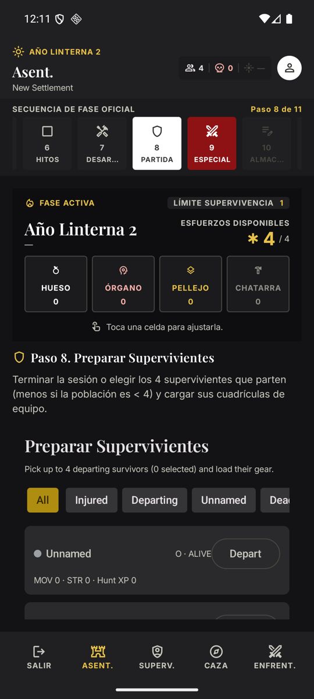
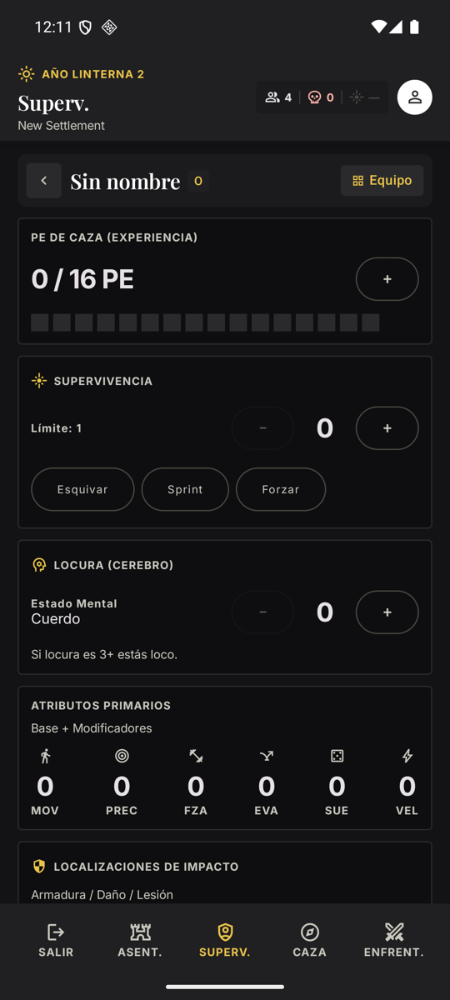
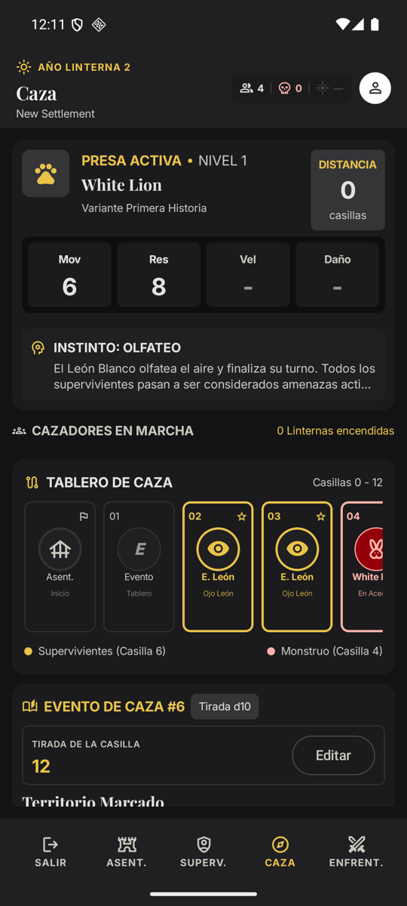
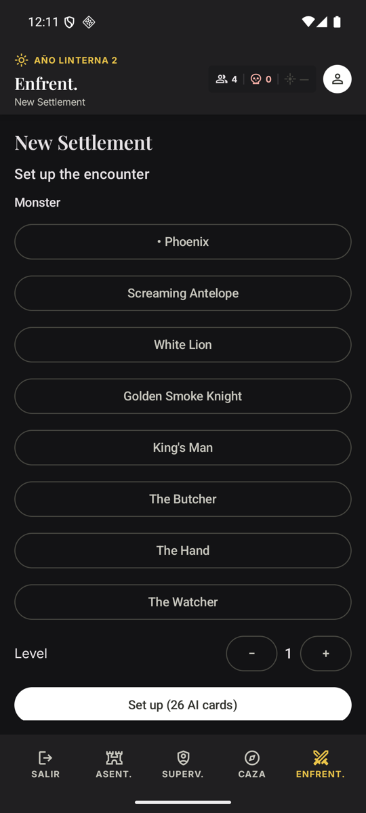

# kdm-tracker

**Gestor de campaña y asentamiento para Kingdom Death: Monster. App Android que funciona sin conexión.**

[Español](README.md) · [English](README.en.md)

[](https://github.com/Alountk/kdm-tracker/actions/workflows/ci.yml)
[](https://github.com/Alountk/kdm-tracker/releases/latest)
[](LICENSE)

<table>
  <tr>
    <td></td>
    <td></td>
    <td></td>
    <td></td>
  </tr>
  <tr align="center">
    <td>Asentamiento</td>
    <td>Supervivientes</td>
    <td>Caza</td>
    <td>Enfrentamiento</td>
  </tr>
</table>

## Qué es

Una app para llevar una campaña de Kingdom Death: Monster en el móvil y seguir el **año linterna**
completo: la fase de asentamiento (sus 11 pasos), la ficha de cada superviviente, la caza sobre su
tablero y el enfrentamiento con el monstruo.

- **Sin conexión primero.** Todo se guarda en el dispositivo; no necesitas servidor para jugar.
- **Sincronización opcional.** Con un servidor propio puedes compartir una campaña con otros
  jugadores mediante un código de invitación.
- **Las reglas son datos.** El contenido del juego vive en paquetes de contenido, no en el código,
  de modo que se pueden añadir ediciones y expansiones sin tocar el motor de reglas.

## Estado

Pre-lanzamiento (**v0.3**), en desarrollo activo. El contenido incluido es una semilla de la
edición 1.6 más las cartas de la 1.5 ya procesadas; no es el juego completo. Lo que falta y el orden
previsto están en el [roadmap](docs/roadmap.md).

## Instalar

Descarga el APK de la [última release](https://github.com/Alountk/kdm-tracker/releases/latest) e
instálalo en un Android 7.0 o superior (hay que permitir la instalación desde orígenes
desconocidos). No hace falta cuenta ni servidor.

## Desarrollar

```bash
git clone https://github.com/Alountk/kdm-tracker.git && cd kdm-tracker
./gradlew :app-android:assembleDebug     # APK en app-android/build/outputs/apk/debug/
./gradlew spotlessCheck :core:jvmTest :data:jvmTest :server:test :app-android:testDebugUnitTest
```

Necesitas JDK 21 y el **Android SDK, incluso para las tareas que no son de Android**. Cómo
instalarlo, arrancar el servidor, Docker y publicar una release: [guía de desarrollo](docs/development.md).

## Cómo está hecho

| Módulo | Qué contiene |
| --- | --- |
| `core` | Dominio y reglas en Kotlin puro (multiplataforma): año linterna, contenido, motor de sincronización |
| `data` | Persistencia local con SQLDelight (SQLite) |
| `app-android` | App Compose Multiplatform + Material 3 |
| `server` | Servidor Spring Boot: hub de sincronización y panel web |

Las reglas de capas y la convención de comentarios están en [ARCHITECTURE.md](docs/ARCHITECTURE.md).

## Evolución

| Fecha | Hito |
| --- | --- |
| 3 oct 2026 | Primer gestor de asentamientos: panel web con supervivientes, recursos, innovaciones y registro |
| 5 oct 2026 | Esqueleto de la app Android sobre el motor de reglas de `core` |
| 6 oct 2026 | Hub de sincronización: autenticación, cambios incrementales y migración de datos |
| 7 oct 2026 | Cartas de la edición 1.5 convertidas en paquetes de contenido |
| 9 oct 2026 | Fase de enfrentamiento: preparación, mazo de IA y desenlace |
| 10 oct 2026 | Tema visual «Atramentum» y estructura de la app con cuatro pestañas |
| 18 oct 2026 | Ficha de superviviente paginada y pantalla de caza |
| 23 oct 2026 | Pasos del tablero de caza y tirada por casilla |
| 27 oct 2026 | Integración continua y primera release firmada (v0.3.0) |

## Documentación

Los documentos técnicos están en inglés.

| Documento | Contenido |
| --- | --- |
| [Guía de desarrollo](docs/development.md) | Requisitos, arranque, tests, variables de entorno y releases |
| [Estructura del proyecto](docs/project-structure.md) | Árbol del repositorio |
| [Arquitectura](docs/ARCHITECTURE.md) | Capas y convención de comentarios |
| [Persistencia y sincronización](docs/sync.md) | Base local, motor de sincronización y campañas compartidas |
| [Servidor](docs/server.md) | API del hub, modelo de conflictos y migración |
| [Paquetes de contenido](docs/content-packs.md) | Contenido como datos y cómo se importa de las cartas |
| [Pasos del asentamiento](docs/settlement-steps.md) | Cómo se implementan los pasos de la fase de asentamiento |
| [Roadmap](docs/roadmap.md) · [Backlog](docs/backlog.md) | Lo que falta |

## Aviso y licencia

Proyecto personal de aficionado, sin relación con Kingdom Death ni con Poots Games. Kingdom Death:
Monster y su contenido pertenecen a sus propietarios.

Código bajo licencia MIT: consulta [LICENSE](LICENSE).
